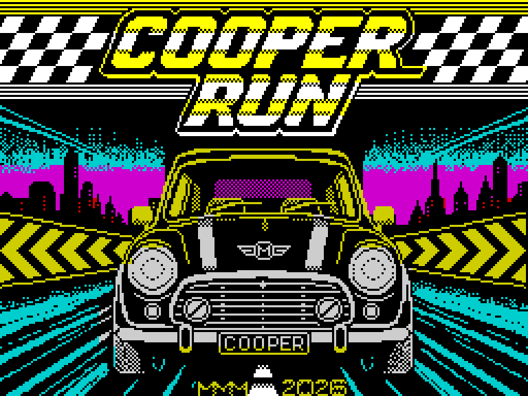

# COOPER RUN — ZX Spectrum

> Thirty cars stand between you and victory.

COOPER RUN is an original vertical arcade racing game written in Z80 assembly
for the ZX Spectrum. Race through five timed stages, overtake the rival cars
and climb from 30th position to first.

**Current release: v1.1 — 23 August 2026**

Version 1.1 introduces a new loading screen and a redesigned main-menu logo.
The racing structure and controls remain those established in v1.0.



## The race

Five stages of 1100 metres stand between you and the finish. Beat the clock on
every stage, overtake the rival cars and finish first to win. Other vehicles are
ordinary traffic: they do not improve your race position, but a collision can
cost valuable time and speed.

## Features

- Five timed racing stages
- Start in 30th position and fight towards first place
- Rival cars plus independent traffic
- Curving road, acceleration, braking, collisions and off-road crashes
- Easy, Normal and Hard difficulty settings
- Keyboard and Kempston joystick support
- Records table with three-letter player names
- Runs on a ZX Spectrum 48K; AY music on compatible 128K systems
- New loading screen in v1.1
- Redesigned main-menu logo in v1.1

## Controls

| Control | Action |
| --- | --- |
| `Q` | Accelerate |
| `A` | Brake |
| `O` / `P` | Turn left / right |
| Kempston up or fire | Accelerate |
| Kempston down | Brake |
| Kempston left/right | Turn |

The main menu also lets you select difficulty, control method and music.

## Download and play

Download [`Cooper_Run_ZX_Spectrum_v1.1.zip`](release/Cooper_Run_ZX_Spectrum_v1.1.zip),
extract it and load `CooperRun.tap` in a real ZX Spectrum or compatible emulator.

On a real machine:

```text
LOAD ""
```

Then start the tape or the device playing the TAP image.

## Version 1.1 artwork

The v1.1 loading screen is new and is credited to **Mário Viegas**.

The main menu also has a new dedicated COOPER RUN logo. Unlike v1.0, the menu
no longer reuses graphics taken from the loading screen; its 9-character-row
logo is stored separately in the game binary.

## Build from source

### Requirements

- Pasmo Z80 assembler
- Python 3
- GNU Make, optional

### Complete TAP

```bash
make
```

The result is written to `build/CooperRun.tap`.

Equivalent manual commands:

```bash
mkdir -p build
cd src
pasmo cooper.asm ../build/cooper.bin ../build/cooper.sym
cd ..
python3 tools/build_tap.py \
  --loader assets/basic_loader.bin \
  --screen assets/loading_screen.scr \
  --code build/cooper.bin \
  --output build/CooperRun.tap
```

The source includes `src/cooperlogo.bin`, which is the menu-logo data embedded
by `cooper.asm`.

To compare the rebuilt files byte-for-byte with the supplied v1.1 release:

```bash
make verify
```

## Repository structure

```text
src/                         Main Z80 assembly source and menu-logo binary
development/                 Supplementary development material
assets/                      BASIC loader, loading screen and menu-logo source
release/                     Ready-to-play v1.1 files
screenshots/                 Game and release visuals
tools/                       TAP-building utility
docs/                        Static GitHub Pages website
```

The ZX Spectrum ROM is deliberately **not included**.

## Screenshot and artwork integrity

The v1.1 loading screen is rendered directly from the supplied 6912-byte SCR
file at an exact 3× nearest-neighbour scale. The gameplay images are genuine
emulator captures from COOPER RUN. The v1.1 menu preview combines the supplied
menu-logo screen data with the unchanged menu text/layout from the released
game, without smoothing or invented pixels.

## Credits and AI disclosure

**Game design and programming:** MMM  
**Loading screen artwork:** Mário Viegas  
**Repository:** MmmPT

Claude AI was used as a programming assistant during development. Design
choices, integration, testing and final release decisions were made by the
author.

## Licensing

Source code in `src/` and `tools/` is released under the MIT License. The game
title, artwork, screenshots, compiled releases and other non-code assets are not
covered by the MIT License. The v1.1 loading screen artwork is credited to
Mário Viegas. See [`LICENSE`](LICENSE) and [`ASSET-LICENSE.md`](ASSET-LICENSE.md).
